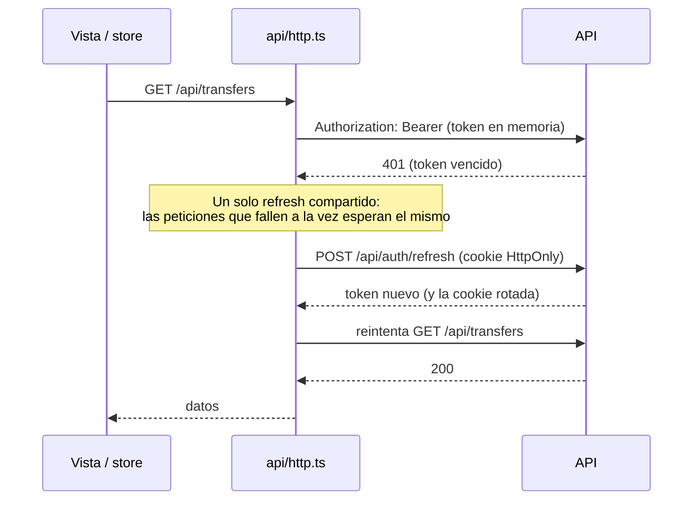

# Logística y Trazabilidad de Stock — Frontend

Interfaz del **Proyecto 21: logística y trazabilidad de stock multi-almacén**: inventario de varias bodegas con costo promedio ponderado, traspasos entre bodegas con estados auditables, mermas, kardex y reportes, dashboard y avisos en tiempo real.

- Aplicación desplegada: https://logistica-backend-3c7w.onrender.com (la sirve el backend, en el mismo origen que la API)
- Backend, modelo de datos y reglas del negocio: [darkninghtt/logistica-backend](https://github.com/darkninghtt/logistica-backend) (su README tiene los diagramas de la base de datos y de los estados de un traspaso)

Stack: Vue 3 (`<script setup lang="ts">`) · Pinia · Vue Router · TypeScript estricto · Vite · axios · Chart.js (`vue-chartjs`) · Vitest + Vue Test Utils.

## Pantallas

| Ruta                             | Qué muestra                                                                                                  | Quién la ve                                                       |
| -------------------------------- | ------------------------------------------------------------------------------------------------------------ | ----------------------------------------------------------------- |
| `/`                              | Dashboard: valor del inventario por bodega, traspasos por estado y mermas de los últimos 30 días             | ADMIN, AUDITOR y jefe de bodega (el operario ve un inicio simple) |
| `/bodegas`, `/productos`         | Catálogo (solo el ADMIN crea y edita)                                                                        | Todos                                                             |
| `/stock`                         | Existencias e historial de movimientos ("Cargar más" por cursor)                                             | Todos (el operario, sin costos)                                   |
| `/stock/entrada`, `/stock/merma` | Registrar una entrada con costo / una merma con motivo                                                       | Según el rol (ver la tabla de roles)                              |
| `/traspasos`, `/traspasos/:id`   | Listado con filtros, detalle con sus acciones (despachar, recibir, resolver, cancelar) y la línea de eventos | Todos (en sus bodegas)                                            |
| `/traspasos/nuevo`               | Crear un borrador                                                                                            | Jefe de bodega y operario                                         |
| `/kardex`, `/reportes`           | Kardex valorizado y reportes de mermas y de mercancía en tránsito, con exportación CSV y PDF                 | ADMIN, AUDITOR y jefe de bodega                                   |
| `/usuarios`                      | Crear y editar usuarios, activarlos o desactivarlos y asignarles bodegas                                     | ADMIN                                                             |
| `/mi-cuenta`                     | Sesiones activas (cerrar una o todas) y cambio de contraseña                                                 | Todos                                                             |

Toda vista muestra los estados de carga, error y vacío; ninguna queda en blanco.

## Arquitectura

```
src/
  api/          único cliente axios (http.ts) y una función por endpoint; los componentes nunca usan axios
  types/        tipos de la API (generados desde el contrato del backend) y tipos propios de la interfaz
  stores/       un store de Pinia por dominio, normalizado (byId + ids) y con estado idle | loading | success | error
  composables/  lógica compartida: useRealtime (WebSocket), useTtlCache (caché), useDownload (exportar)
  router/       rutas y guard asíncrono (restaura la sesión, comprueba permisos y guarda la ruta de retorno)
  layouts/      marco de la aplicación (menú según el rol, indicador de conexión, avisos)
  views/        una vista por pantalla
  components/   piezas reutilizables
  permissions.ts  qué puede hacer cada rol en la interfaz (solo comodidad: la seguridad está en el backend)
```

- El estado de un formulario o de una sola vista se queda en el componente; lo compartido va en los stores.
- **Caché con TTL** (`useTtlCache`): cada lista recuerda su última consulta durante 60 s; cambiar de página o de filtro siempre va al servidor. Guardar algo invalida las listas afectadas, también las de otros stores.
- **Reintentos de red:** `api/http.ts` reintenta hasta 2 veces (1 s y 2 s) solo los `GET` que fallan por red o con `502/503/504`. Un `POST` nunca se reintenta solo, para no duplicar una operación.
- Al cerrar o perder la sesión, un plugin de Pinia vacía todos los stores, así un usuario nunca ve datos del anterior.

## Sesión

El **access token vive solo en memoria** (`src/api/token.ts`), nunca en `localStorage`, `sessionStorage` ni en estado persistido. El refresh token lo maneja el navegador en una cookie `HttpOnly` que JavaScript no puede leer.



- Al recargar la página, el guard de rutas restaura la sesión llamando a `POST /api/auth/refresh` una sola vez.
- Si el refresh es rechazado, se limpia la sesión y se vuelve al login con la ruta de retorno.
- Cerrar sesión llama a `POST /api/auth/logout`, que revoca la sesión en el servidor.

## Roles

El rol llega con el usuario de la sesión y la interfaz se adapta (menú, botones y rutas con `meta.permission`; sin permiso, el guard lleva a `/sin-permiso`). **La seguridad real está en el backend**: cada endpoint comprueba el rol y la bodega y responde `403` si no corresponde.

| Rol               | Catálogo     | Stock y costos                | Entradas y mermas              | Traspasos                                                   | Kardex y reportes | Usuarios |
| ----------------- | ------------ | ----------------------------- | ------------------------------ | ----------------------------------------------------------- | ----------------- | -------- |
| ADMIN             | ver y editar | todas las bodegas, con costos | entradas en todas              | resolver discrepancias                                      | todas             | sí       |
| WAREHOUSE_MANAGER | ver          | sus bodegas, con costos       | entradas y mermas en las suyas | crear, cancelar, despachar, recibir y resolver en las suyas | sus bodegas       | no       |
| OPERATOR          | ver          | sus bodegas, **sin costos**   | mermas en las suyas            | crear, cancelar los propios y recibir en las suyas          | no                | no       |
| AUDITOR           | ver          | todas las bodegas, con costos | no                             | solo ver                                                    | todas             | no       |

Las columnas de costo se ocultan porque la API no las envía al OPERATOR (no solo por el rol): en los tipos, los costos son opcionales.

## Tiempo real

`useRealtime` pide un ticket de un solo uso (`POST /api/realtime/ticket`) y abre el WebSocket del mismo origen (`/api/realtime?ticket=...`). Si la conexión se corta, reconecta con espera creciente y un ticket nuevo en cada intento, y se cierra al cerrar sesión. Los eventos `transfer.updated` y `stock.changed` invalidan la caché de los stores afectados y vuelven a pedir lo que está en pantalla; un aviso visible indica cuándo llega un traspaso a una bodega del usuario. Sin conexión de tiempo real la aplicación sigue funcionando: los datos se piden al entrar a cada vista.

## Contrato de tipos con el backend

Los tipos de la API no se escriben a mano: `npm run api:types` genera `src/types/api.generated.ts` con `openapi-typescript` a partir del `openapi.json` del backend (que sale de sus esquemas Zod), y los tipos de `src/types/` son alias, por ejemplo `type Warehouse = ApiSchema<'Warehouse'>`.

- El script lee `../logistica-backend/openapi.json`, así que espera los dos repos como carpetas hermanas.
- El CI descarga el `openapi.json` de `main` del backend y falla si los tipos generados no coinciden. Después de fusionar un cambio de la API en el backend: `npm run api:types` aquí y subir el resultado.
- `openapi-typescript` declara compatibilidad con TypeScript 5; el `overrides` de `package.json` le indica usar el TypeScript 6 del proyecto.

## Correrlo en local

Requisitos: Node.js 24 (ver `.nvmrc`) y el backend corriendo en el puerto 3000 (ver su README; `npm run seed:demo` deja usuarios de cada rol y datos de ejemplo).

```bash
npm install
npm run dev        # http://localhost:5173; /api (y el WebSocket) se reenvían al backend
```

Si el backend está en otra dirección: `VITE_API_PROXY_TARGET=http://localhost:4000 npm run dev`.

En producción no hay servidor propio del frontend: el `Dockerfile` del backend clona este repo, ejecuta `npm run build` y sirve `dist/` desde el mismo origen que la API.

## Pruebas y scripts

| Script              | Qué hace                                                       |
| ------------------- | -------------------------------------------------------------- |
| `npm run dev`       | Servidor de desarrollo de Vite                                 |
| `npm run build`     | `vue-tsc` y build de producción en `dist/`                     |
| `npm run lint`      | ESLint (incluida la regla de que solo `api/http.ts` usa axios) |
| `npm run typecheck` | `vue-tsc --noEmit`                                             |
| `npm test`          | Pruebas con Vitest                                             |
| `npm run api:types` | Regenera los tipos de la API desde el contrato del backend     |
| `npm run format`    | Aplica Prettier                                                |

Las pruebas cubren los stores (estados, caché e invalidación), los composables (WebSocket simulado, caché), el cliente axios (refresh compartido, reintentos) y las vistas con sus estados de carga, error y vacío. El CI corre lint, typecheck, pruebas, build y el chequeo del contrato en cada PR y en `main`.
